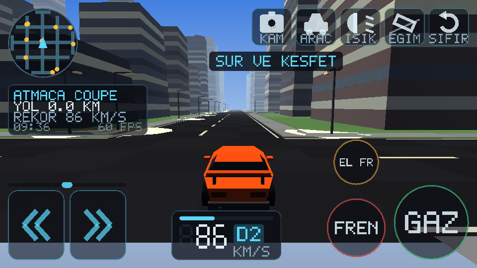
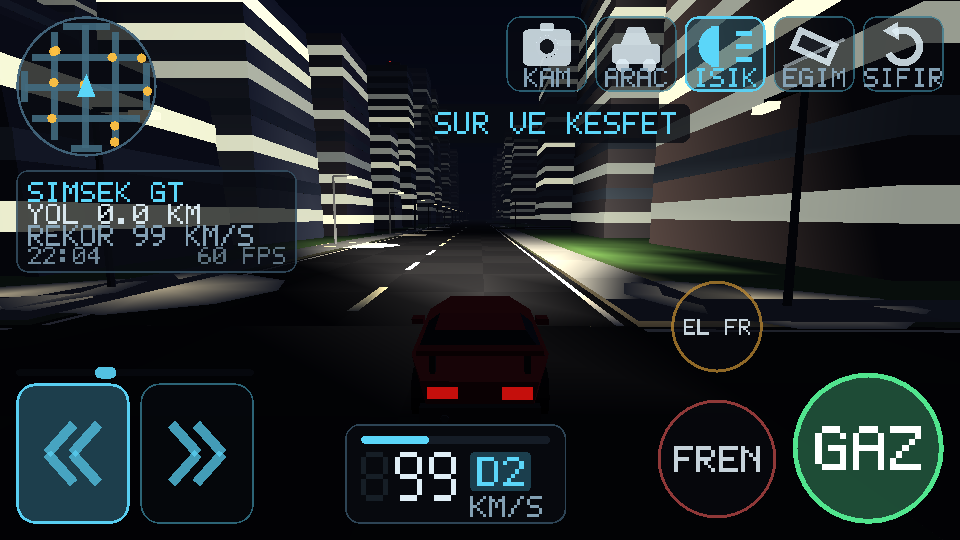
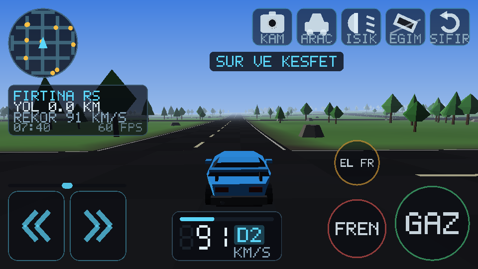
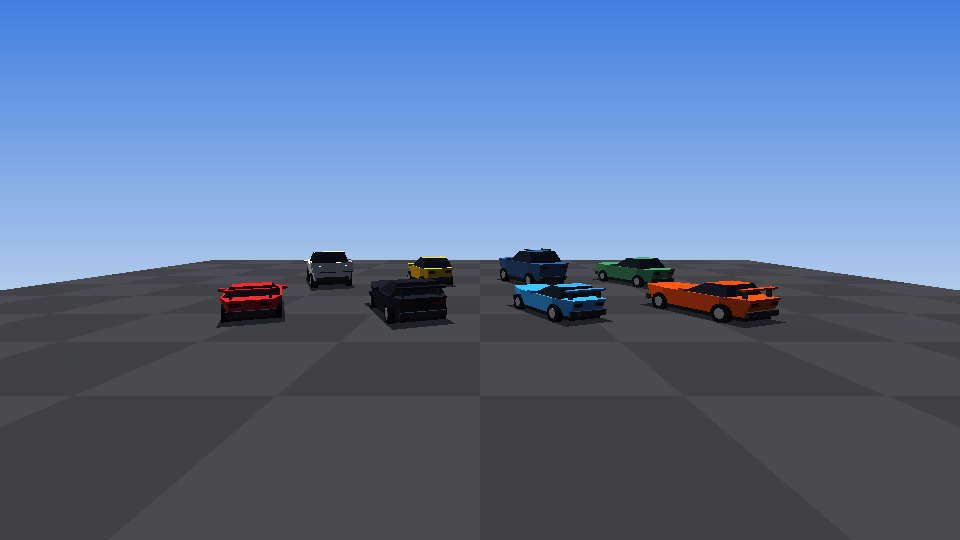

# İlker Drive

Android için açık dünya araba sürme oyunu. Sonsuz, prosedürel olarak üretilen
bir şehir ve kırsalda serbest sürüş: şerit çizgili yollar, kavşaklar, gökdelenler,
ağaçlar, sokak lambaları, trafik ve tam bir gündüz–gece döngüsü.

Oyun motoru dahil her şey bu depodaki Java kaynağından geliyor. Hiçbir hazır
oyun motoru, hiçbir 3B model dosyası, hiçbir doku, hiçbir ses dosyası yok —
araçların gövdeleri, binalar, arazi ve motor sesi hepsi kod içinde üretiliyor.
Bu yüzden APK sadece **96 KB**.

| | |
|---|---|
|  |  |
|  |  |

## Kurulum

`dist/ilker-drive-1.8.apk` dosyasını telefonuna kopyala ve aç. Android
"bilinmeyen kaynaklardan yükleme" izni isteyecek; tarayıcına veya dosya
yöneticine bu izni ver.

Android 5.0 (API 21) ve üzeri, OpenGL ES 2.0 destekleyen her cihazda çalışır.
Oyun yatay moda kilitlidir.

## Kontroller

| Kontrol | Yer |
|---|---|
| Direksiyon | Sol alttaki iki ok. Basılı tuttuğun sürece direksiyon üçte bir saniyede sonuna kadar kırılır, bırakınca hemen ortalanır. Kısa dokunuş küçük bir düzeltmedir |
| Gaz / Fren | Sağ alttaki yuvarlak düğmeler |
| El freni | Frenin üstündeki turuncu düğme. Aracı hızlı durdurur ve yokuşta tutar |
| KAM | Kamerayı değiştirir: takip → kaput → geniş açı |
| ARAC | Garajdaki sekiz araç arasında geçiş yapar |
| ISIK | Far modu: otomatik → kısa → uzun → kapalı |
| EGIM | Telefonu yana yatırarak direksiyon. Açtığın andaki duruşun nötr kabul edilir |
| SIFIR | Takılırsan seni en yakın yola geri koyar |

Sol üstte pusula gibi dönen bir mini harita, altında mesafe / hız rekoru / saat,
altta ortada hız paneli var. Sarı noktalar trafikteki diğer araçlar. Ekranın
ortası bilerek boş bırakıldı — bakman gereken yer orası.

## Sürüş

Fizik elle ayarlanmış tutuş sayılarından değil, **aks yüklerinden** türüyor.
Her aksın taşıdığı ağırlık var; hızlanınca ve frende ağırlık akslar arasında
geçiyor; bir aksın yanal olarak yapabileceği şey, taşıdığı yük çarpı lastik
sürtünmesi. Bunun önemi şu: yükü belirleyen şey aynı zamanda aksın itilmeye ne
kadar direndiğini de belirliyor, yani araç **varsayılan olarak nötr**. Elle
ayarlanmış iki sayıdan kazara kararsız bir araç çıkması mümkün değil.

Her aracın tek bir **denge** eğilimi var: önden alınıp arkaya eklenen küçük bir
miktar. Araç limitte önce önden kayıyor, yani dışarı açılıyor — kıç atmıyor.

**Direksiyon bir açı değil, bir viraj isteğidir.** Yarım direksiyon, aracın
sahip olduğu yanal kuvvetin yarısını ister; hangi hızda olursan ol. Sabit bir
virajın gerektirdiği açı yaklaşık `eğrilik × dingil mesafesi` — park ederken
kilidin tamamı, otoyolda birkaç derece — ve araca verilen tam olarak bu.

Bunun üstüne üç şey, üçü de gerçek arabalarda var:

- **Direksiyon dönüşü izliyor.** Gazdayken burun hafifler ve araç dışarı
  kaçmak ister. Direksiyon, istenen dönüş hızıyla gerçekleşeni karşılaştırıp
  eksik kalanı ekliyor — bir sürücünün düşünmeden yaptığını, cam ekrandaki bir
  başparmağın yapamadığını. Arka limitteyken asla daha fazlasını istemiyor;
  yoksa aracı döndürmek yerine çevirirdi.
- **Ön lastik tepe noktasını geçmiyor.** Lastik eğrisi 9.3 derecede zirve yapıp
  düşüyor. Direksiyon, ön aksın gerçekte gittiği yöne bakıp lastiği tam o
  zirvede tutuyor. Zirveyi aşan her derece daha *az* viraj demek.
- **ESP ve çekiş kontrolü.** Araç limitte dönerken ve direksiyon sonuna kadar
  kırılıyken motor torku kısılıyor. Bu olmadan, gaz hep basılı olduğu için
  araç viraj boyunca hızlanıyor, daire hızın karesiyle açılıyor ve viraj hiç
  bitmiyordu. Çekiş kontrolü de virajda motorun fazlasını keserek arkanın
  patinajla dönmesini engelliyor; düz kalkışta ise patinaja izin veriyor.

**Sürtünme dairesi iki yönlü.** Arka lastiğin çekişe harcadığı tutuş yana
kalmaz, yana harcadığı da çekişe kalmaz. İki yön de aynı sabit kapasiteye göre
ölçülüyor — birbirinin artığına göre ölçmek arkayı kendi kendine çökerten bir
geri besleme döngüsü yaratıyordu. Ve sadece arka aksa uygulanıyor, çünkü çeken
aks orası; öne de uygulamak gazdayken her virajı dışarı kaçan bir viraja
çeviriyordu.

**Kırılı tekerin kuvveti aracı yavaşlatır.** Ön lastik kendi tekerine dik
iter, teker de kırılı olduğu için o itişin bir kısmı geriye bakar. Virajda hız
kaybının bir kısmı buradan geliyor.

Lastiğin sertliği **statik yüke**, tavanı **anlık yüke** bağlı. Gerçek
lastikler böyle: yük azalınca küçük kaymalara aynı sertlikle cevap verir ama
daha erken tepe yapar. Sertliği de anlık yüke bağlamak gazı virajın tamamı
boyunca önü yumuşatan bir şeye çeviriyordu.

**Frenler lastiği yenemez.** Fren, motor freni ve yuvarlanma direncinin hepsi
aynı lastiklerden geçtiği için tek bir bütçeye konuluyor ve o bütçe `tutuş × g`
ile sınırlı. Hava direnci lastikten geçmediği için onun dışında ve
sınırlanmıyor. Teker kilitlendiğinde kayan lastik daha *az* tutuyor, daha çok
değil. Sonuç: 100-0 mesafesi 36 ile 49 metre arası — gerçek araçlar 36-42.

Motor **gerçek bir şanzımandan** çekiyor: bir tork eğrisi, içinde bulunduğu
vitesin oranıyla çarpılıyor. Vites değişiminde tork kesilir ve devir düşer.
Çekiş de tutuşa bağlı: arka aksın yükü çarpı lastik sürtünmesi, artı tam gazda
üstüne binen çökme.

Gövde zemine yapışık değil: kendi dikey hızını taşıyor. **Kaldırımdan hızlı
inersen araç havalanır**, yerçekimi geri indirir, yaylar oturur. Yerçekimi
yokuş boyunca da etki ediyor — yokuş yukarı yavaşlarsın, aşağı hızlanırsın,
ve el freni çekmezsen park ettiğin araç geri kaçar.

Bunun yanında:

- **Ağırlık transferi** — gaza ve frene göre, ağırlık merkezi yüksekliğiyle
  ölçeklenerek. SUV'un yüksek merkezi onu frende daha çok öne yatırıyor.
- **Sürtünme dairesi** — aracı ileri itmek için harcanan tutuş, onu döndürmek
  için kalmaz. İki aksa birden uygulanıyor, yani tam gaz dengeyi bozmaz.
- **Patinaj** — güçlü araçlarda dururken tam gaz lastikleri döndürür.
- **Fren kilitlenmesi** — sert frende tekerler kilitlenir, direksiyon işlemez
  olur ve ön lastikler iz bırakır.
- **Lastik izleri**, **çarpışma**, **far konileri**, **lastik ciyaklaması**,
  **kamera titreşimi**, **trafik**, **geri vites**.

## Garaj

Sekiz aracın hepsi `CarSpec.GARAGE` içindeki sayılarla tanımlı: lastik
sürtünmesi, ağırlık dağılımı, ağırlık merkezi yüksekliği, dingil mesafesi,
direksiyon kilidi, güç. Kuvvetler bunlardan türediği için yeni bir araç
eklerken kararlılık hesabı yapman gerekmiyor — model onu kendisi halleder.

`90°` sütunları oyuncunun gerçekten yaşadığı şey: gaz basılı, sağ ok basılı,
araç 90 derece dönene kadar geçen süre — ekrandaki gerçek tuş kodundan geçerek
ölçüldü.

| Araç | Tutuş | 0-100 | Son hız | 100-0 | 90° duruştan | 90° 80 km/s'ten |
|---|---|---|---|---|---|---|
| ATMACA COUPE | 1.00 | 5.2 sn | 230 km/s | 38 m | 2.8 sn | 4.2 sn |
| FIRTINA RS | 0.98 | 5.0 sn | 248 km/s | 39 m | 2.7 sn | 4.4 sn |
| KAS MUSCLE | 0.92 | 5.5 sn | 256 km/s | 42 m | 2.8 sn | 4.6 sn |
| SIMSEK GT | 1.08 | 4.3 sn | 277 km/s | 36 m | 2.9 sn | 4.1 sn |
| KLASIK SEDAN | 0.88 | 7.2 sn | 216 km/s | 44 m | 2.9 sn | 4.6 sn |
| KARTAL SUV | 0.78 | 8.2 sn | 209 km/s | 49 m | 3.4 sn | 5.4 sn |
| MINIK HATCH | 0.86 | 10.1 sn | 169 km/s | 44 m | 2.8 sn | 4.6 sn |
| YUK PICKUP | 0.80 | 10.0 sn | 184 km/s | 48 m | 3.0 sn | 4.9 sn |

80 km/s'ten 90 derecelik bir şehir kavşağına girmek gerçekte de mümkün değil;
o hızda en dar daire ~55 metre. Kavşak için fren var.

## Derleme

Android SDK (platform 35, build-tools 35.0.0) ve JDK 17+ gerekiyor.
`local.properties` içine SDK yolunu yaz:

```
sdk.dir=/senin/android/sdk/yolun
```

Sonra:

```bash
gradle assembleRelease      # dist'teki APK böyle üretildi
gradle assembleDebug
```

Release derlemesi, `keystore.properties` yoksa debug anahtarıyla imzalanır —
yani kutudan çıktığı gibi derlenir ve kurulur. Kendi anahtarınla imzalamak
için depo kökünde şöyle bir dosya oluştur (bu dosya `.gitignore`'da):

```properties
storeFile=/yol/anahtar.jks
storePassword=...
keyAlias=...
keyPassword=...
```

> Not: `dist/` içindeki APK debug anahtarıyla imzalı. Yeni bir sürüm derlersen
> imza değişeceği için üstüne kuramazsın; önce eskisini kaldır. Kalıcı bir
> anahtar oluşturursan bu sorun ortadan kalkar.

## Doğrulama

Bu depoda emülatör gerektirmeyen bir test koşumu var. Oyunun **gerçek kaynak
dosyalarını** masaüstü JVM'de derleyip çalıştırır (`android.opengl.Matrix`
yerine birebir aynı davranan bir kopya konur):

```bash
tools/harness/run.sh            # 440 kontrol
tools/harness/run.sh --preview  # kontroller + docs/*.png görüntülerini yeniden üretir
```

Kontrol ettikleri: arazi yüksekliğinin sürekliliği ve belirleyiciliği, chunk
geometrisinin indeks sınırları içinde kalması, her üçgenin doğru yöne bakması
(arka yüz eleme yanlış sarımlı üçgenleri yutar), araç gövdelerinin tutarlılığı,
her aracın ilan ettiği son hıza ulaşması, frenin geri vitese geçmesi, el
freninin gerçekten kaydırması, toprakta yavaşlaması ve frustum elemesi.

**Sürüş mekaniği testleri**: her aracın altı vitesi de kullanması ve vites
değişiminde devrin düşmesi, devir sınırlayıcısının tutması, yavaşlarken vites
küçültmesi, her aracın 0-100 süresinin inandırıcı bir aralıkta olması, yokuşta
park eden aracın geri kaçması ve el freninin onu tutması, kaldırımdan hızlı
inen aracın havalanıp geri inmesi, süspansiyonun dururken oturması.

**Parmak testi** şikayetin kendisi: gaz basılı, ok basılı — araç dönüyor mu?
Ekrandaki gerçek dokunma kodundan geçiyor, yani tuş rampası, fizik ve
aradaki her şey birlikte sınanıyor. Her araç için: duruştan 3.6 saniyede,
80 km/s'ten 6.2 saniyede 90 derece dönmesi, dönerken hızlanıp virajdan
kaçmaması, kısa dokunuşun küçük bir düzeltme olması, okun neresine basılırsa
basılsın aynı dönmesi, tam kilide üçte bir saniyede ulaşıp bırakınca ortalanması.

Bu test yazılmadan önceki sürümde araç gaz basılıyken 130 metrelik bir daire
çiziyordu ve daire giderek açılıyordu. Önceki bütün testler direksiyonu
doğrudan sayı olarak veriyor, hızı sabit tutuyor ve virajın ilk anını
ölçüyordu. Oyuncu bunların hiçbirini yapmaz.

**Dönüş testleri** her aracı beş hızda, sonsuz ve düz bir test pistinde
ölçüyor — oturmuş virajı, ilk anın tepe değerini değil: tam direksiyonun
aracın tutuşunu gerçekten kullandığı, yarıçapın hızla büyüdüğü, kavşak hızında
dar dönebildiği, yarım direksiyonun yarım viraj verdiği, ön lastiğin kendi tepe
noktasının ötesine itilmediği, limitte önce önün kaydığı ve aracın direksiyona
yarım saniyenin altında cevap verdiği.

**Kararlılık testleri**: sekiz aracın her biri, dört ayrı hızda, dört ayrı
direksiyon miktarında ve üç ayrı gaz konumunda — 384 kombinasyon — virajı
kaymadan alıyor mu. Kaymanın ölçüsü arka lastiğin kayma açısı, gövdenin açısı
değil: yürüme hızında dar dönen bir araç dört lastiği de tutarken salt
geometriden dolayı yolundan 25 derece içeri bakar. Ayrıca her aracın öne doğru
denge eğilimi taşıdığı, tam gazda dümdüz gittiği, viraj ortasında gaz kesilince
ters dönmediği ve el freninin aracı yana atmadığı doğrulanıyor.

Bu testler yazılmadan önce **sekiz aracın sekizi de her hızda fırıl dönüyordu**;
0.25 direksiyon bile yetiyordu. O zamanki testler yalnızca araçları birbiriyle
karşılaştıran göreli sorular soruyordu — "şu araç bundan daha çok kayıyor mu"
gibi. İki araç da savrulurken bu sorunun cevabı doğru çıkar. Bir test takımının
en tehlikeli boşluğu yanlış cevaplanan soru değil, hiç sorulmamış olandır.

**Arayüz testi** ise tek bir parmağı beş farklı ekran oranında (16:9'dan 5:4'e)
ekranın her yerinde gezdirip hiçbir noktanın aynı anda iki kontrolü birden
tetiklemediğini doğruluyor — geliştiricinin kendi telefonunda görünmeyen,
başkasının telefonunda sinir bozucu olan türden bir hata.

**Çarpışma testi** en kritiği: dünya üreticisinin çizdiği duvarlarla çarpışma
kutularının aynı yerde olduğunu doğruluyor. Bunun için bina yerleşimi ile bina
görünümü ayrı rastgele akışlardan besleniyor; böylece çarpışma yürüyüşü hiçbir
renk veya pencere sayısı okumadan mesh'in gezdiği aynı binaları geziyor. Test
iki yönü de kontrol ediyor: bildirilen her kutunun üstünde gerçekten bir bina
var mı, ve araç gövdesi yüksekliğindeki her katı yüzey çarpışma listesinde mi.
Ayrıca bir araç duvara sürülüp içine girmediği ve hız kaybettiği ölçülüyor.

`Preview.java` oyunun kendi gölgelendirici matematiğini taklit eden küçük bir
yazılımsal rasterleştirici; `HudPreview.java` ise gerçek `Hud` kodunu masaüstünde
çalıştırıp ürettiği üçgenleri o sahnenin üzerine çiziyor. Yukarıdaki ekran
görüntüleri bunlarla üretildi — yani arayüz, cihaz olmadan da gerçekten
görülerek tasarlandı. Hepsi geliştirme aracı, APK'ya girmiyorlar.

## Nasıl çalışıyor

```
app/src/main/java/com/ilker/opendrive/
├── MainActivity, GameView, GameRenderer   oyun döngüsü, kamera, ışık
├── gl/      MeshBuilder  prosedürel geometri (prizma, silindir, konik kutu)
│            Mesh, SceneProgram, HudProgram, Frustum, ShaderUtil
├── world/   Terrain      dünyanın tanımı: yükseklik, biyom, yol ağı
│            ChunkBuilder arazi + yol + bina + ağaç ağlarını üretir
│            World        oyuncunun etrafındaki chunk akışı
├── game/    CarSpec, CarMesh, Car, Traffic, CarModels
├── ui/      Hud, PixelFont
└── audio/   EngineSound  AudioTrack üzerine sentezlenen motor sesi
```

Dünyanın tamamı koordinatların saf bir fonksiyonu: `Terrain.height(x, z)`
her zaman aynı cevabı verir, bu yüzden chunk'lar herhangi bir sırada, herhangi
bir iş parçacığında üretilebilir ve birbirleriyle her zaman uyumlu olur. Chunk
üretimi iki arka plan iş parçacığında, GPU'ya yükleme ise kare başına en fazla
iki chunk ile sınırlı — böylece sürüş sırasında takılma olmuyor.

Sahnenin tamamı tek bir gölgelendiriciyle çiziliyor: yönlü güneş ışığı, gökyüzü
dolgusu, üstel sis, pencereler ve lambalar için ışıma kanalı, gece için far
konisi.

---

`index.html` bu depodaki ayrı bir proje (İlker web uygulaması) ve oyunla
ilgisi yoktur.
